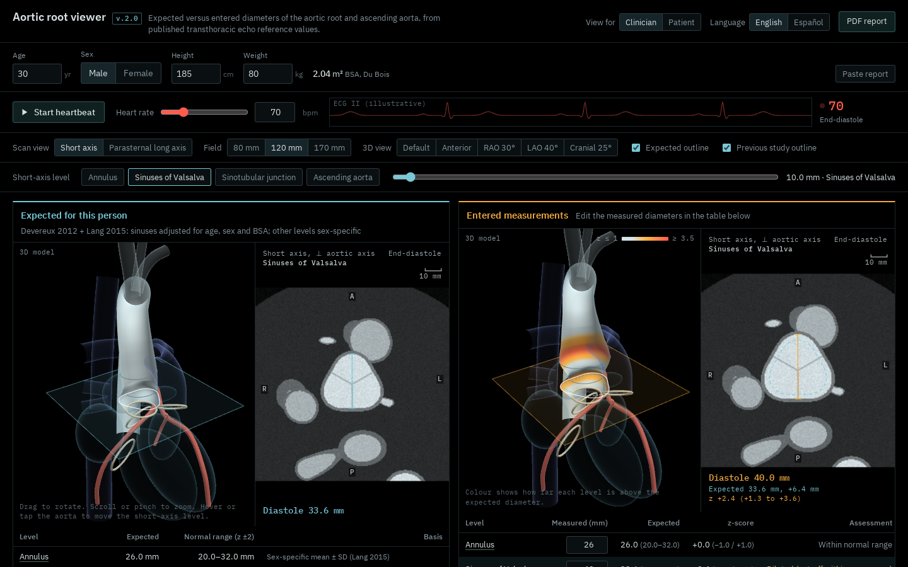
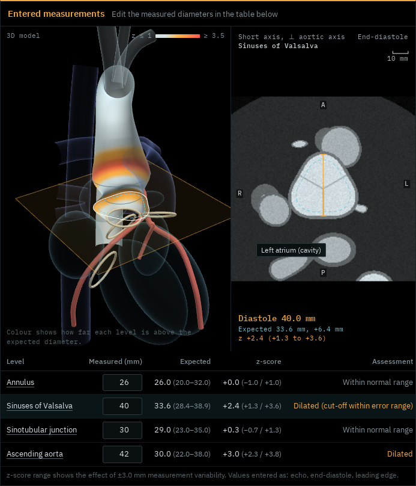
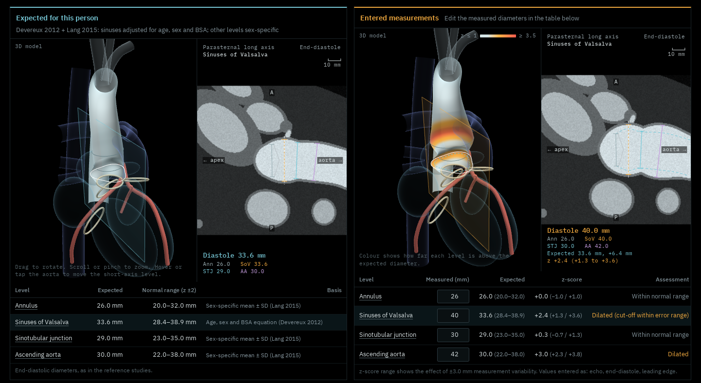
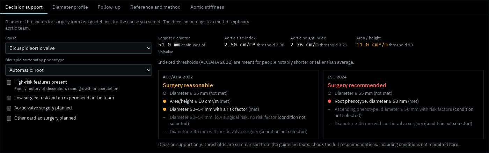
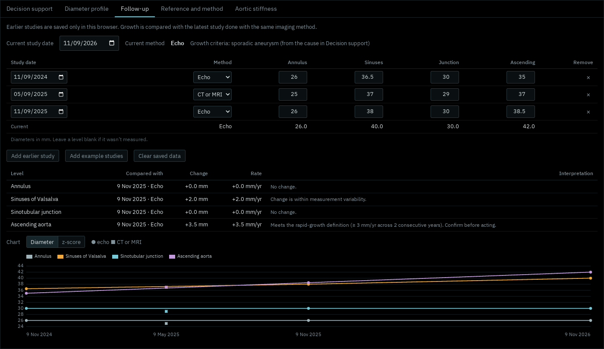
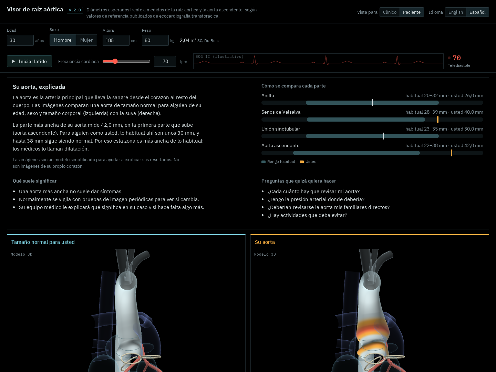
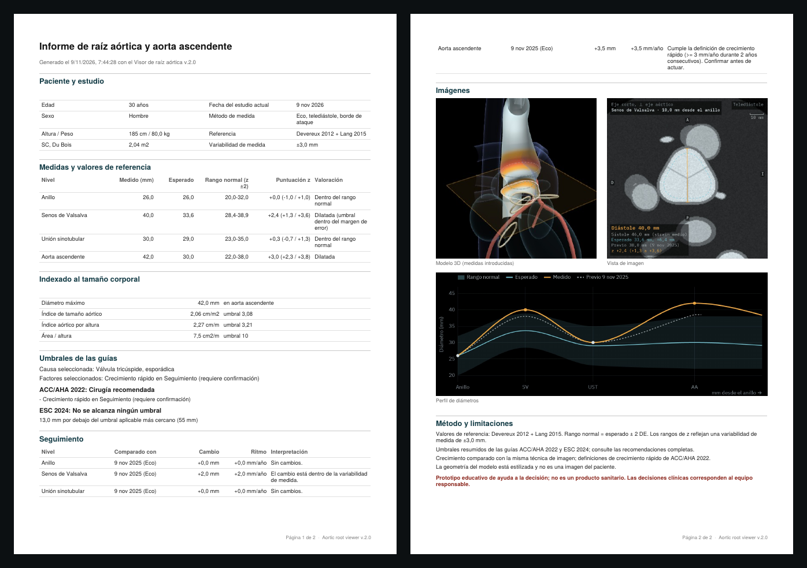
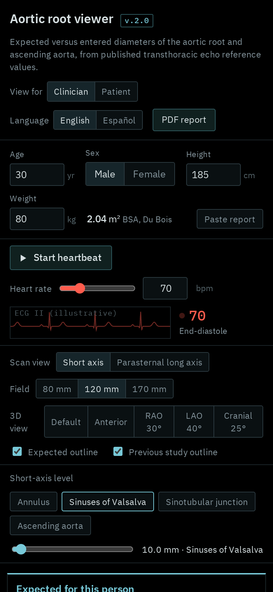

# Aortic root viewer v2.0

An interactive, evidence-based viewer that shows how a dilated aortic root and ascending aorta compare with the expected size for a person’s age, sex and body size. It runs entirely in the browser as a single HTML page.

> **Educational decision-support prototype, not a medical device.** Thresholds and reference values are summarised from published sources; clinical decisions belong to the treating team.

**Live demo:** https://dgalgom.github.io/aortic-root-viewer/



## Features

- **Two rotatable 3D hearts side by side**: expected aorta versus the entered measurements, coloured by z-score.
- **Echo-style scan views**: a short-axis cut perpendicular to the aortic axis (follows the cursor along the aorta) and a parasternal long-axis view with calipers. Hovering names each structure.
- **Heartbeat**: cardiac timing by heart rate and sex (Weissler equations), aortic pulsation, valve motion and an illustrative ECG.
- **Reference sets**: Devereux 2012, Lang 2015 (ASE/EACVI) and WASE 2022, with z-score ranges for measurement variability and warnings for other measurement conventions.
- **Decision support**: ACC/AHA 2022 and ESC 2024 surgical thresholds by cause, plus indexed measures (aortic size index, aortic height index, area/height).
- **Follow-up**: earlier studies (stored only in the browser), growth compared within the same imaging method, rapid-growth definitions, diameter or z-score over time.
- **Aortic stiffness**: strain, distensibility and stiffness index β; measured strain drives the patient model’s pulsation.
- **Report import**: paste text from an echo or CT report (English or Spanish); values are previewed before applying.
- **One-click PDF report** with data, thresholds, follow-up and images.
- **English and Spanish interface**, and a **plain-language patient view**.

## Screenshots

| | |
|---|---|
|  |  |
| **Scan recognises structures.** Hovering the short-axis view names what is under the cursor. | **Parasternal long axis.** Calipers at the four measured levels, colour-coded. |
|  |  |
| **Decision support.** Example: bicuspid valve, root phenotype, 51 mm sinuses. | **Follow-up.** Growth compared within the same imaging method. |
|  |  |
| **Patient view (Spanish).** Plain-language summary and questions to ask. | **PDF report (Spanish).** Data, thresholds, follow-up and images. |

<p align="center"><br><em>Phone layout</em></p>

Screenshots were rendered in headless Chromium with software WebGL; colours and fonts match the live page.

## Repository structure

```
src/
  index.template.html    Page markup with placeholders for styles, methods text and script
  styles.css             All styles (single dark, scanner-style theme)
  methods/en.html        "How values are calculated" section, English
  methods/es.html        Same section, Spanish
  js/01-i18n.js          English and Spanish strings, formatting helpers
  js/02-core-models-3d.js  Evidence constants, reference equations, cardiac cycle, geometry, anatomy, 3D viewers
  js/03-scan-and-charts.js Scan rasterizer, overlays, diameter profile and growth charts
  js/04-features-and-ui.js Follow-up, decision support, report import, PDF report, patient view, UI and start-up
build.mjs                Assembles dist/index.html
dist/index.html          Built page, identical to the published version
index.html               Redirects the GitHub Pages root to dist/
docs/screenshots/        Images used in this README
tests/run-tests.cjs      Headless test suite (jsdom)
tests/syntax-check.cjs   Parses the built script
docs/EVIDENCE.md         Every encoded value, its source and verification status
CHANGELOG.md             Version history
```

The files in `src/js` are ordered fragments of one script scope, not ES modules: the build concatenates them in name order inside a single strict-mode function.

## Build and test

Requires Node.js 18 or later.

```bash
npm install        # dev dependencies only: jsdom, three 0.128.0, jspdf 2.5.1 (for tests)
npm run build      # writes dist/index.html
npm test           # builds, then runs the 23 headless tests
```

## Running and deploying

Open `dist/index.html` in a browser, or serve the repository from any static host. On GitHub Pages (Settings → Pages → deploy from `main`, root folder) the root `index.html` redirects to the viewer. At run time the page loads:

- three.js r128 from cdnjs (`https://cdnjs.cloudflare.com/ajax/libs/three.js/r128/three.min.js`)
- jsPDF 2.5.1 from cdnjs, only when a PDF report is requested
- IBM Plex Sans and Mono from Google Fonts (with system-font fallbacks)

Inside Claude the PDF download uses the platform’s download permission; elsewhere it falls back to a normal browser download. Follow-up studies and settings are kept in `localStorage` in the user’s own browser and are never sent anywhere.

## How it was built

The interface was developed in claude.ai with **Claude Opus 5.5**, using web search (to find and verify reference values and guideline thresholds), code execution (to build, test and profile the page, including headless-browser screenshots to check for overlapping text) and Artifacts (to publish it). Sources that could not be verified, such as the Campens 2014 coefficients, were deliberately left out.

## Limitations

- Geometry is stylized: the aorta is generated from four diameters, and chambers, valves and other vessels are drawn for orientation only.
- Lang 2015 values are not adjusted for age or body size; WASE values come from two concordant secondary transcriptions of the paper’s tables.
- Guideline thresholds are summaries; conditions not modelled (for example Turner syndrome, vascular Ehlers–Danlos syndrome, gene-specific Loeys–Dietz thresholds in ACC/AHA) are stated in the interface.
- Not validated on patient data and not a medical device. Clinical use would require validation and regulatory assessment (in the EU, the Medical Device Regulation).

See `docs/EVIDENCE.md` for the full source list.

## Citation

Citation metadata is in `CITATION.cff`; GitHub shows a “Cite this repository” button from it.

## Licence

Copyright 2026 Daniel Gallardo Gómez. Licensed under the [Apache License, Version 2.0](LICENSE). See [NOTICE](NOTICE) for attribution and the third-party libraries the page loads at run time (three.js and jsPDF, MIT licence; IBM Plex fonts, SIL Open Font License 1.1).
